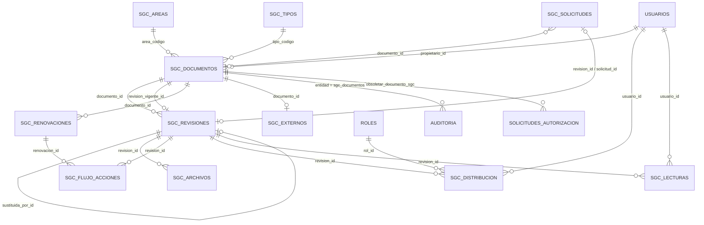

# Documentos SGC · Modelo de datos

Tablas del módulo (prefijo `sgc_`), creadas por las migraciones 22, 23 y 24 (`src/lib/server/migraciones/`). Las fechas se guardan como texto: `AAAA-MM-DD` las fechas y ISO 8601 en UTC los instantes. Los tipos son los de SQLite; en MySQL/MariaDB, `INTEGER` es `INT`, `TEXT` es `LONGTEXT` y las tablas usan `utf8mb4`.

El módulo también usa tablas generales de la plataforma: `usuarios`, `roles`, `usuario_roles`, `rol_acciones` (las 14 acciones documentales, módulo `documentos`), `auditoria` (bitácora sellada), `reautenticaciones` (contraseña en acciones críticas) y `solicitudes_autorizacion` (segundo usuario para la obsolescencia).

## Diagrama entidad–relación

Las relaciones son lógicas: el código las valida y no hay llaves foráneas declaradas, igual que en el resto de la plataforma.

## Reglas que garantiza la base

| Regla | Cómo |
| --- | --- |
| Clave única (CA-03) | `sgc_documentos.clave` es única y se guarda normalizada: mayúsculas y sin espacios. |
| Una sola revisión vigente por documento (CA-05) | Índice único parcial `uq_sgc_revisiones_vigente` (SQLite) o columna generada con índice único (MySQL). Junto con el `UPDATE … WHERE estado = 'autorizada'` resuelve dos publicaciones simultáneas: una gana y la otra recibe 409. |
| Archivo inmutable tras enviar a revisión (CA-06) | Disparadores `sgc_archivos_solo_borrador_ins` y `_upd`: no se agregan ni cambian archivos de una revisión que no está en borrador. |
| Ningún archivo se borra | Disparador `sgc_archivos_sin_delete`. Sustituir un archivo marca el anterior con `reemplazado_en`. |
| Un archivo activo por tipo y revisión | Índice único parcial `uq_sgc_archivos_activo (revision_id, tipo) WHERE reemplazado_en IS NULL`. |
| Un acuse por persona y revisión (CA-11) | `UNIQUE (revision_id, usuario_id)` en `sgc_lecturas`. |
| Bitácora inalterable (CA-12) | Los disparadores de `auditoria` impiden `UPDATE` y `DELETE`, y cada entrada va sellada en cadena. |

## Diccionario de datos

### `sgc_areas`: áreas de gestión (carpetas)
| Columna | Tipo | Para qué sirve |
| --- | --- | --- |
| id | INTEGER | Identificador. |
| codigo | VARCHAR(4) | Sigla única: GC, TH, AD, CO, TC o DI. |
| nombre | VARCHAR(80) | Nombre de la gestión. |
| color | VARCHAR(7) | Color HEX del área. Identifica el área, nunca el estado. |
| orden | INTEGER | Orden de las carpetas. |
| activo | INTEGER | 1 si está en uso. |

### `sgc_tipos`: tipos documentales
| Columna | Tipo | Para qué sirve |
| --- | --- | --- |
| id | INTEGER | Identificador. |
| codigo | VARCHAR(2) | M, P, F, L, I, B o R (único). |
| nombre | VARCHAR(60) | Manual, Procedimiento, Formato/registro… |
| descripcion | TEXT | Uso del tipo, según la especificación. |
| flujo_predeterminado | VARCHAR(40) | Flujo de aprobación (hoy, el estándar). |
| orden, activo | INTEGER | Orden y vigencia del tipo. |

### `sgc_documentos`: ficha del documento
| Columna | Tipo | Para qué sirve |
| --- | --- | --- |
| id | INTEGER | Identificador interno único. |
| clave | VARCHAR(80) | Clave FX, o identificador del emisor si es externo. Única y normalizada. |
| titulo | VARCHAR(300) | Título completo. |
| area_codigo, tipo_codigo | VARCHAR | Área de gestión y tipo documental. |
| origen | VARCHAR(10) | `interno` o `externo`. |
| proceso | VARCHAR(200) | Proceso o subproceso. |
| confidencialidad | VARCHAR(20) | `uso_interno`, `restringido` o `confidencial`. |
| palabras_clave | TEXT | Lista JSON para la búsqueda. |
| propietario_id | INTEGER | Propietario. En un externo, es su responsable de seguimiento. |
| estado | VARCHAR(20) | `en_elaboracion`, `vigente` u `obsoleto`. |
| revision_vigente_id | INTEGER | Revisión vigente actual. |
| creado_por/en, actualizado_por/en | | Quién y cuándo creó o modificó la ficha. |
| obsoleto_en, obsoleto_por, motivo_obsolescencia | | Datos de la obsolescencia aprobada. |

### `sgc_revisiones`: revisiones (versiones) del documento
| Columna | Tipo | Para qué sirve |
| --- | --- | --- |
| id | INTEGER | Identificador. |
| documento_id, numero | INTEGER | Documento y número de revisión (únicos juntos). |
| estado | VARCHAR(20) | `borrador`, `en_revision`, `en_autorizacion`, `autorizada`, `vigente`, `obsoleta` o `cancelada`. |
| fecha_emision, fecha_vigencia, fecha_proxima_revision | VARCHAR(10) | Fechas de control. Hay aviso cuando faltan 30 días o menos para la próxima revisión, o ya pasó. |
| motivo_cambio, apartados_afectados, descripcion_cambio | TEXT | Datos del cambio. |
| elaborador_id, revisor_id, autorizador_id | INTEGER | Responsables asignados: siempre tres personas distintas (regla 11). |
| enviada_revision_en/por, revisada_en/por, autorizada_en/por, publicada_en/por | | Trazabilidad de cada paso (CA-07). |
| fecha_limite | VARCHAR(10) | Fecha límite opcional del trabajo. |
| cancelada_en/por | | Revisión rechazada o cancelada (se conserva). |
| sustituida_por_id | INTEGER | Revisión que la sustituyó al publicarse. |
| fecha_obsolescencia | VARCHAR(40) | Cuándo pasó a obsoleta. |
| ubicacion_historica, regla_conservacion | TEXT | Retención. |
| origen_registro | VARCHAR(20) | `flujo`, `carga_inicial` o `externo`. |
| solicitud_id | INTEGER | Solicitud que la originó. |
| renovada_en | VARCHAR(40) | Última renovación sin cambios. |
| version_externa | VARCHAR(120) | Versión o fecha de edición del emisor, en los externos (migración 24). |
| creado_por/en, actualizado_por/en | | Auditoría de la fila. |

### `sgc_archivos`: archivos de cada revisión
| Columna | Tipo | Para qué sirve |
| --- | --- | --- |
| id | INTEGER | Identificador. |
| revision_id | INTEGER | Revisión a la que pertenece. |
| tipo | VARCHAR(10) | `pdf` (consulta) o `fuente` (docx, xlsx, pptx o pdf). |
| nombre_original | VARCHAR(255) | Nombre con que se subió. Solo se muestra; nunca se usa como ruta. |
| nombre_almacenado | VARCHAR(255) | Ruta relativa `<documento>/<revision>/<uuid>.<ext>` dentro de `instance/sgc/`. |
| extension, mime, tamano_bytes | | Validados al subir (firma de bytes y límite de tamaño). |
| sha256 | VARCHAR(64) | Huella. Se verifica al abrir el archivo y al restaurar un respaldo. |
| subido_por, subido_en | | Quién y cuándo lo subió. |
| reemplazado_en, reemplazado_por | | Sustituido en borrador; el archivo se conserva. |

### `sgc_solicitudes`: solicitudes de documento nuevo o de cambio
| Columna | Tipo | Para qué sirve |
| --- | --- | --- |
| tipo | VARCHAR(20) | `nuevo` o `cambio`. |
| documento_id | INTEGER | Documento que se quiere cambiar. |
| area_codigo, tipo_codigo, titulo_propuesto | | Datos de un documento nuevo. |
| necesidad, justificacion | TEXT | Por qué se pide; la justificación es obligatoria. |
| solicitante_id, creado_en | | Quién y cuándo. |
| estado | VARCHAR(20) | `pendiente`, `aceptada` o `rechazada`. |
| resuelta_por, resuelta_en, comentario_resolucion | | Decisión de Mejora Continua. |
| revision_id, clave_asignada | | Revisión abierta y clave autorizada al aceptar. |
| apoyo_nombre_original, apoyo_nombre_almacenado, apoyo_sha256, apoyo_tamano_bytes, apoyo_mime | | Archivo de apoyo opcional. |

### `sgc_flujo_acciones`: línea de tiempo (CA-07)
| Columna | Tipo | Para qué sirve |
| --- | --- | --- |
| revision_id | INTEGER | Revisión. |
| accion | VARCHAR(40) | `solicitar`, `aceptar_solicitud`, `enviar_revision`, `revisar_aceptar`, `revisar_devolver`, `revisar_rechazar`, `autorizar`, `autorizar_devolver`, `autorizar_rechazar`, `publicar`, `obsoleta`, `reasignar`, `renovacion_iniciar`, `renovacion_confirmar`, `renovacion_autorizar`, `renovacion_rechazar`, `externo_registrar`, `externo_verificar` y `externo_version`. |
| decision | VARCHAR(20) | Decisión tomada, si aplica. |
| comentario | TEXT | Comentario obligatorio al devolver o rechazar. |
| usuario_id, cargo, papel | | Quién decidió, su cargo y su papel: elaborador, revisor, autorizador, publicador o responsable. |
| renovacion_id | INTEGER | Si la acción es de una renovación. |
| fecha | VARCHAR(40) | Fecha y hora. |

### `sgc_renovaciones`: renovación sin cambios
| Columna | Tipo | Para qué sirve |
| --- | --- | --- |
| documento_id, revision_id | INTEGER | Documento y revisión vigente que se renueva. |
| estado | VARCHAR(20) | `en_revision`, `en_autorizacion`, `completada` o `cancelada`. |
| revisor_id, autorizador_id | INTEGER | Responsables de la renovación. |
| fecha_proxima_anterior, fecha_proxima_nueva | VARCHAR(10) | Fecha de próxima revisión antes y después. |
| fecha_limite, solicitado_por, creado_en, revisada_en, autorizada_en, cancelada_en/por | | Control y trazabilidad. |

### `sgc_externos`: seguimiento de documentos externos (CA-10)
| Columna | Tipo | Para qué sirve |
| --- | --- | --- |
| documento_id | INTEGER | Ficha del externo (único). |
| fuente | VARCHAR(200) | Emisor o fuente (IMNC, SSA, AOAC…). |
| version_fecha | VARCHAR(80) | Versión o fecha de edición vigente. |
| enlace | TEXT | Enlace de consulta (solo http o https). |
| responsable_id | INTEGER | Responsable de seguimiento (igual al propietario de la ficha). |
| ultima_revision, proxima_revision | VARCHAR(10) | Última verificación de vigencia y próxima revisión. |
| creado_en, actualizado_en | | Auditoría de la fila. |

### `sgc_distribucion`: destinatarios de una revisión (CA-11)
| Columna | Tipo | Para qué sirve |
| --- | --- | --- |
| revision_id | INTEGER | Revisión distribuida. |
| rol_id / usuario_id | INTEGER | Destinatario por rol (incluye a quien reciba el rol después) o por persona. |
| punto_uso | VARCHAR(200) | Dónde se usa el documento. |
| requiere_lectura | INTEGER | 1 si exige el acuse de lectura. |
| creado_por, creado_en, motivo | | Alta del destinatario (motivo desde la migración 24). |
| retirado_en, retirado_por, motivo_retiro | | Baja del destinatario; los acuses ya registrados se conservan. |

### `sgc_lecturas`: acuses de lectura (CA-11)
| Columna | Tipo | Para qué sirve |
| --- | --- | --- |
| revision_id, usuario_id | INTEGER | Persona y revisión exacta (únicos juntos). |
| abierto_en | VARCHAR(40) | Primera apertura del PDF vigente en el visor; el acuse la exige. |
| notificado_en | VARCHAR(40) | Último recordatorio enviado. |
| leido_en | VARCHAR(40) | Fecha y hora del acuse. No se deshace. |
| estado | VARCHAR(20) | `pendiente` o `leido`. |

## Archivos fuera de la base

`instance/sgc/<documento>/<revision>/<uuid>.<ext>`: PDF y archivos fuente. `instance/sgc/solicitudes/<solicitud>/<uuid>.<ext>` guarda los archivos de apoyo. La base solo guarda el nombre y el SHA-256. La carpeta entra completa en los respaldos; ver [RESPALDO_RESTAURACION.md](RESPALDO_RESTAURACION.md).
